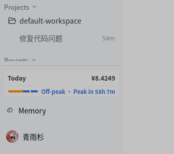

# DSH 档案调优：缩放、插件去重、侧栏空按钮

> 记录时间：2026-10-23
> 机器：Ubuntu 26.04.1 LTS / GNOME 50.1 (Wayland) / eDP-1 1920×1080@60
> 涉及：DSH Tauri 桌面端、`better-deepseek-harness-codex` 档案、GNOME 显示缩放与应用网格

这篇是 [README.md](../README.md) 里 DSH 桌面端那部分的续篇：桌面端能跑起来之后，继续处理**界面比例、插件冗余、以及一个侧栏底部多出来的空按钮**。三件事的共同点是——都不是改代码能解决的，得先看清运行时到底在渲染什么。

---

## 1. 显示比例：125% 缩放比塞大字体更靠谱

### 现象

14 寸 1080p（340mm × 190mm），GNOME 默认 100% 缩放，系统字体 11pt。GNOME 自己的面板勉强能看，但 QQ、LX Music 这类应用的正文明显偏小。

### 判断

先量出真实密度：1080p / 14" ≈ 157 PPI，1.0 缩放意味着所有 UI 都按 96 DPI 画，等于把字缩到约 61%。这种屏本来就应该上 125%。

### 修复

GNOME 没有 `gsettings set scale` 这种键，只能走 Mutter 的 D-Bus 接口 `org.gnome.Mutter.DisplayConfig.ApplyMonitorsConfig`。`scripts/set-scale.py` 就是这段调用的封装：

```bash
python3 scripts/set-scale.py 1.25   # 放大
python3 scripts/set-scale.py 1.0    # 回退
```

脚本要点：

- 用 `GetCurrentState` 取当前 mode id 与 serial，再按 `(x, y, scale, transform, primary, monitors)` 组装逻辑显示器。
- `method=3`（persistent）才会写 `~/.config/monitors.xml`，`method=2` 只对当前会话生效。
- 参数结构是 `a(iiduba(ssa{sv}))`：**逻辑显示器本身没有 props**，props 在每个显示器条目里（`(connector, mode, props)`）。第一版照抄 `GetCurrentState` 的 7 元组会直接报 `Tuple mismatches number of elements`。

### 为什么不改 text-scaling-factor

`text-scaling-factor` 只放大字号，行高、图标、内边距都不动，结果是文字互相挤。显示缩放是整层放大，排版不变形。两者叠加会双重放大，所以保持 `1.0`。

### 经验

- Wayland 下没有 `xrandr --scale`；分数缩放必须走 Mutter。
- 改完用 `GetCurrentState` 回读确认，而不是相信命令退出码。
- Xwayland 应用的虚拟分辨率会跟着变（本次 `xrandr` 从 1920×1080 变成 3072×1728），属正常现象。

---

## 2. GNOME 应用网格密度：尝试过，**未采用**

### 现象

1920×1080、125% 缩放下应用网格是 7 列 × 3 行、图标 96px，一屏装的东西偏少。

### 调研结论（这部分仍然有效）

GNOME 50 的 `js/ui/iconGrid.js` 里：

- 每页行列数来自固定的 `defaultGridModes`，按屏幕宽高比挑一档，**没有 gschema 可调**；
- 图标尺寸在 `fixed-icon-size === -1` 时按 `IconSize.LARGE`（96）算；
- 页成员是在插入时按 `itemsPerPage`（columns × rows）定的。

### 尝试

写了一个本地扩展 `grid-density@local`：替换 `_gridModes`、直接写 `layout_manager.columnsPerPage/rowsPerPage`、在 `Main.overview` 的 `showing/shown` 上再应用一次，并调用 `AppDisplay._redisplay()` 重新分页。

### 结果：不稳定，已回退

| 阶段 | 观察 |
|---|---|
| 首次启用 | 网格确实变成 10 列，但图标仍是 96px（`adaptToSize` 因页面尺寸未变 early-return，不重算图标），标签被下一行图标压住 |
| 加 `_pageWidth=-1` 强制重算 + `_redisplay()` | 打开总览后 800ms 的探针仍是 `columns=7 rows=3`：`AppGrid` 在 allocation 时按自己的 modes 重新套用，注入被覆盖 |
| 用实例级 `_findBestModeForSize` 覆盖 | `currentMode` 始终是 `-1`，说明覆盖没被调用到；改成直接写布局属性也只是短暂生效 |
| 重启机器后 | 完全回到默认 7×3，扩展处于启用状态却无效果 |

### 为什么放弃

- 这是 **Shell 内部布局**，不是公开 API；`AppGrid` 每次 allocation 都会重算 mode，注入点要么被覆盖、要么根本没被调用。
- 即使列数改成功，**分页也不会自动重排**（页成员在插入时固定），需要额外触发 `_redisplay()`，而它和布局重算的时序很难保证。
- 每轮修改都要**注销重启 shell** 才能加载（GJS 模块缓存，GNOME 50 没有实现 `org.gnome.Shell.Extensions.ReloadExtension`），试错成本对用户太高。

**现状（2026-10-24 更新）**：扩展已彻底移除——`~/.local/share/gnome-shell/extensions/grid-density@local` 已删除，仓库里的源码也一并删掉，只在本文保留这段失败记录；`enabled-extensions` 现在只剩 `quiet-startup@local`。

**如果还要做**，只剩两条路：装一个维护中的第三方网格扩展（要在 extensions.gnome.org 上确认支持 GNOME 50），或者直接改 shell 源码（不建议）。本文不再提供这段代码。

---

## 3. 安装整合包：4 处必须手改的地方

整合包 `better-deepseek-harness-codex` v2.8.1（24 个插件）装成独立档案时，装了四道坎：

| # | 现象 | 根因 | 处理 |
|---|------|------|------|
| 1 | 安装报「整合包不合法：manifest.launchers 必须是对象」 | 包用的是旧的数组形式，插件 0.3.5 的 `validateLaunchers` 只接受对象 | 把 `["dshl","dsh-packforge-app"]` 改写成 `{id: {supported: true}}`，重打包本地副本再装 |
| 2 | 6 个插件被静默跳过（`skipping profile bundle`） | 它们的 peer 只声明到 `0.2.0-rc.2`，运行时是 `0.2.1-rc.2` | 用 `dsh plugin allow-version <pkg@ver> --dsh-version 0.2.1-rc.2 --accept-risk` 逐个写进档案的 `compatibility.json` |
| 3 | `codex-ui` 等 12 个插件卡在 pending | `dsh-prompt@0.3.0` 硬依赖 `@deepseek-ai/dsh-storage-domain@0.2.0-rc.2`，把运行时的 0.2.1-rc.2 遮蔽了 → `storage-domain` 行被判定不兼容而禁用，级联 | `pnpm-workspace.yaml` 加 `overrides` 强制到 `0.2.1-rc.2`（注意 pnpm 11 已不读 package.json 的 `pnpm.overrides`） |
| 4 | `subagent-director` import 失败 | 它引用的 `settleRun` 在新运行时里已被删除 | `cordis.patch.yml` 停用该行 |

### 经验

- 整合包的 `manifest` 校验比包本身老，2026-10 的 0.3.5 已经开始要求 r2 结构；装老包先看 `pack/view` 的报错点。
- `dsh --profile <name> --dump-config` 是最快的静态验证：能看到 `skipping`、`disabled`、以及每个 bundle 的最终行。**它不会启动插件**，比反复重启便宜。
- 想让插件真正跑起来，用临时 `DSH_HOME` + `--port 0` 起一次性实例探针，不污染正在用的环境。

---

## 4. WorkBuddy 插件升级：网络是唯一的敌人

`dsh-workbuddy-connect` 从 0.7.1 升到 0.7.9（README 的版本表：内核 `0.2.1-rc.2` → `0.7.9`）。版本本身没问题，问题是 0.7.9 拖进来 85 个包（AWS SDK、`@google/genai`、`protobufjs`），拉包时 `registry.npmjs.org` 反复 `ECONNRESET` / error 23，第一次 `dsh plugin add` 跑了 10 分钟被我自己的超时掐断，留下「package.json 还是 0.7.1、node_modules 已是 0.7.9」的半截状态。

处理：

1. 手动把 `package.json` 的 spec 改成 `0.7.9`；
2. `pnpm install --prefer-offline --fetch-retries=6 --fetch-timeout=180000` 补完；
3. `protobufjs` 与 `@google/genai` 有 build script，被 pnpm 拦下会以非零退出，需要在 `pnpm-workspace.yaml` 里写 `onlyBuiltDependencies` / `allowBuilds` 才不报 `ERR_PNPM_IGNORED_BUILDS`。

还有一个坑：**`pnpm config set --location project` 会往 `.npmrc` 写，但重复执行会把 `allowBuilds` 写成两遍导致 YAML 重复键**——手动编辑 `pnpm-workspace.yaml` 时一定要先去重。

---

## 5. 插件冗余：三组重叠，删两组

38 个 bundle 里查到三组功能重叠：

| 功能 | A | B | 结论 |
|------|---|---|------|
| Windows 桌面操控 | `dsh-computer-use`（window2） | `dsh-computer-use-win`（MCP + PowerShell UIA） | 同功能，Linux 上两个都不可用 → 删 B |
| 额度显示 | `dsh-cost-meter`（成本 + 订阅额度） | `@goodandready/dsh-key-limits`（额度 chip） | 重叠，且 B 没配任何 key（`credentials: {}`）→ 删 B |
| 桌宠 | `dsh-whale-girl-pet`（网页内） | `dsh-tauri-pet`（Tauri 置顶窗） | 包级冗余但 tauri-pet 属桌面端内置、缺宠物包不渲染 → 保留两者 |

删除方式走官方通道，别手改 `package.json`：

```bash
cd ~/.dsh/profiles/better-deepseek-harness-codex
DSH_HOME=~/.dsh dsh plugin --profile better-deepseek-harness-codex \
  remove dsh-computer-use-win @goodandready/dsh-key-limits
```

`dsh plugin` 会调 pnpm 并自动把包从 `dsh.profile.bundles` 里对账掉。注意 `pnpm remove` **不接受** `--prefer-offline`（那是 install 的选项），加了会直接报 `Unknown option`。

结果：依赖 36 → 34，bundle 38 → 36，组合树 354 个节点、0 条 `skipping`。

---

## 6. 侧栏底部多出来的空按钮

这是这次最值得记的一个：**看起来像 UI bug，实际是插件之间「只关了一半」的典型**。

### 现象

codex-ui 档案的侧栏左下角，「设置」下面多出一个同款圆角、但**没有任何内容**的空 pill，hover 才有底色。

### 取证

GNOME 的 WebKit 界面没法开 devtools，但页面本身是普通网页。用 geckodriver + headless Firefox 打开 `http://127.0.0.1:3080/?token=<启动日志里的 token>`，直接读 DOM：

```html
<footer class="dcu-foot">
  <div class="dcu-footer-actions">…（今日费用 / Off-peak / Memory）…</div>
  <div class="dcu-settings-seat">
    <button data-settings-trigger="dsh-tauri-ui" class="… h-[42px] rounded-[12px] bg-transparent">
      <div data-slot="settings.trigger" style="display: contents;"></div>  <!-- 空 -->
    </button>
  </div>
</footer>
```

空壳就是那个 42px 按钮：圆角、内边距都在，内部的 `settings.trigger` 槽一个子节点都没有。

### 根因

`settings.trigger` 的内容由 `@deepseek-ai/dsh-client-ui-settings-general` 提供，而 `@michengai/dsh-codex-ui` 的 bundle patch 里写着：

```yaml
- id: ui-settings-general
  disabled: true
```

它为了换成自己的设置页把内容提供方关了，但没关 `dsh-tauri-ui` 那个按钮壳，槽没人填 → 只剩壳。

### 修复

在档案 `cordis.patch.yml` 末尾反向启用（patch 对 `disabled:` 是整键替换）：

```yaml
- id: ui-settings-general
  disabled: false
```

重启后底部座位变成**账号菜单**（头像 + 昵称），点开是 `Settings / Feedback / Sign out`，`Settings` 打开的就是官方设置对话框。



### 顺带澄清一个误判

一开始我以为会变成「两套设置页」，实测不是：对话框只有一个，分区由各插件挂进去——

`Account / General`（settings-general）、`Models`（tauri-model）、`Built-in plugins` 与 `Plugin configuration`（settings-plugins + plugin-manager）、`Agent presets`、`Cost`（cost-meter）、`桌宠配置`、`Remote access`、`Prompt Templates`、`Archive`、`Wallpaper Engine`、`Codex UI`（codex-ui）。

`codex-ui` 注册的 section id 是 `codex-ui`，`settings-general` 是 `general`，不撞名，所以列表里 `General` 与 `Codex UI` 各一条，不是重复项。

### 经验

- **「有壳没内容」优先查对应 slot 由谁注册**。DSH 的 UI 是 slot 拼装：壳（`sidebar.settings`）与内容（`settings.trigger` / `settings.section`）来自不同插件，一方被禁用就只剩空壳。
- **bundle patch 的 `disabled: true` 不会连带清理下游壳**，这是第三方整合包最容易忽略的耦合。
- 排查运行中的 UI，geckodriver + `execute/sync` 比反复重启+截图快得多；token 在 `desktop.log` 的 `dsh web: http://127.0.0.1:3080/?token=…` 行里。
- 用 `curl` 取这些 `plugins/??…` 资源时记得 `-g --path-as-is`，否则 `??` 会被当成 query 而 404。

---

## 7. 可复用脚本

| 脚本 | 用途 |
|------|------|
| `scripts/set-scale.py` | Mutter 显示缩放（1.0 / 1.25 / 1.5），持久化到 monitors.xml |
| `scripts/restart-dsh.sh` | 延迟完全退出并重启 DSH（`setsid nohup ./restart-dsh.sh 20`），日志 `/tmp/dsh-relaunch.log` |
| `dsh/profile-config/` | 本次档案的配置快照（`package.json` / `cordis.patch.yml` / `compatibility.json` / `pnpm-workspace.yaml`），不含 `node_modules` |

## 8. 回滚

```bash
# 缩放
python3 scripts/set-scale.py 1.0
# 网格扩展
rm -rf ~/.local/share/gnome-shell/extensions/grid-density@local
# 插件去重（恢复删除前状态）
cp ~/.dsh/.plugin-backups/<timestamp>-dedupe/{package.json,pnpm-lock.yaml} \
   ~/.dsh/profiles/better-deepseek-harness-codex/
cd ~/.dsh/profiles/better-deepseek-harness-codex && pnpm install
# 空按钮修复
# 删掉 cordis.patch.yml 末尾的 `- id: ui-settings-general / disabled: false` 三行
```

## 9. 经验清单

1. **先量 PPI 再谈缩放**：1080p/14" 用 100% 必然偏小，125% 比调字号正确。
2. **GNOME 没有网格密度设置**，只能扩展改 `_gridModes` + `fixed-icon-size`；新扩展必须重登一次。
3. **整合包安装失败先看 `--dump-config`**，`skipping` / `pending` / `disabled` 是三类不同的问题。
4. **peer 版本区间不含当前运行时 ≠ 不能用**，但要用 `allow-version` 显式承担风险，并记在 `compatibility.json`。
5. **官方包的版本钉死会遮蔽运行时版本**，`overrides` 要写在 `pnpm-workspace.yaml`（pnpm 11 不读 package.json 的 `pnpm` 字段）。
6. **UI 空壳优先怀疑 slot 提供方被禁用**，而不是样式问题。
7. **headless 浏览器是读 WebKit 应用 DOM 的可靠手段**，比 `gnome-screenshot`（Wayland 下还被 D-Bus 权限挡住）靠谱。
8. **删除插件走 `dsh plugin remove`**，让它对账 `bundles`；手改很容易留下悬挂条目。

## 10. 补充：`dsh-ui` 卡片不是 Markdown，依赖 genui 客户端插件

### 现象

助手回复里的 ` ```dsh-ui ` 围栏被当成普通代码块，界面直接显示原始 JSON。

### 根因

`dsh-ui` 不是 Markdown 扩展，而是 `@changfenhuang/dsh-genui` 提供的渲染器：host 半负责教模型说这种围栏，浏览器半注册真正的卡片渲染。当前档案是从整合包安装的 `better-deepseek-harness-codex`，它的依赖里**没有 genui**（原来的 `tauri` 档案里有），所以围栏退化成代码块。

### 怎么判断（别靠猜）

直接看服务端渲染出来的 boot 载荷里有没有这个客户端条目：

```bash
curl -s http://127.0.0.1:3080/ | grep -o '"id":"@changfenhuang/dsh-genui"'
```

没有输出 = 渲染器没装；有输出但界面仍是 JSON = 页面需要刷新。

### 修复

```bash
cd ~/.dsh/profiles/better-deepseek-harness-codex
DSH_HOME=~/.dsh dsh plugin --profile better-deepseek-harness-codex add @changfenhuang/dsh-genui@0.14.0
```

装完**不需要重启 DSH**：宿主会热加载，技能目录里立刻出现 `genui` 技能、boot 载荷里出现客户端条目；已打开的页面刷新一次即可。

### 经验

- “渲染没生效”先分清两种情况：**模型没写对格式**，还是**客户端没装渲染器**。后者查 boot 载荷最快。
- 整合包会替换掉宿主默认的一部分插件组合，换档案后要重新确认“上一套能力还在不在”，不要假定某个功能仍然可用。
